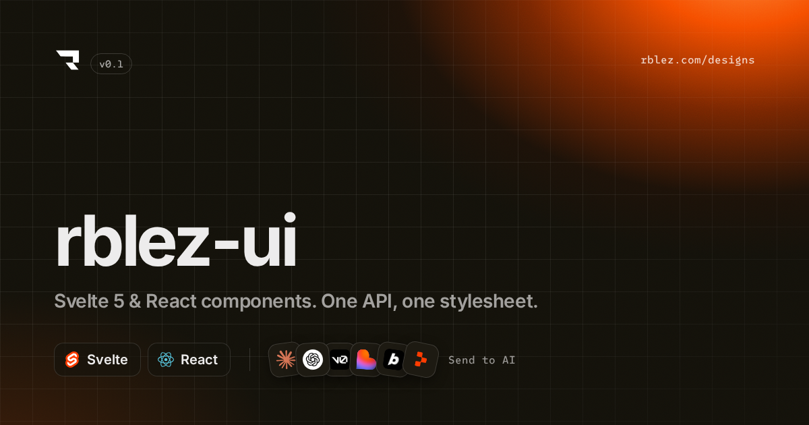

<p align="center">
  
</p>

# rblez-ui

[](https://github.com/rblez/ui/actions/workflows/ci.yml)
[](https://github.com/rblez/ui/actions/workflows/pages.yml)
[](https://github.com/rblez/ui/releases)


**ES** · Componentes web en TypeScript para **Svelte 5** y **React 18+**, con una sola API, un único CSS y tokens compartidos.
**EN** · TypeScript web components for **Svelte 5** and **React 18+** — one API, one stylesheet, shared tokens.

Docs: **[www.rblez.com/ui](https://www.rblez.com/ui/)** · [GitHub Pages](https://rblez.github.io/ui/) · [Changelog](./CHANGELOG.md) · [Releases](https://github.com/rblez/ui/releases)

## Componentes / Components

| Grupo | Componentes |
|---|---|
| IA / AI | `PromptInput` |
| Formularios / Forms | `Button`, `Input`, `Textarea`, `Switch`, `Select` |
| Layout | `Grid`, `Card`, `Sidebar`, `Footer`, `ProfileSettings`, `NotFound` |
| Overlay | `Modal`, `BottomSheet` |
| Feedback | `Badge`, `Kbd`, `Toast` (`Toaster` + `toast()`) |
| Base | `Icon` (Ionicons, línea y relleno), tokens |

## Paquetes / Packages

| Paquete | Contenido |
|---|---|
| `@rblez-ui/tokens` | `tokens.css`, `components.css`, `prompt-input.css`, iconos y tipos |
| `@rblez-ui/svelte` | Componentes Svelte 5 (runes) |
| `@rblez-ui/react` | Componentes React 18+ |

```ts
import "@rblez-ui/tokens/css";
import "@rblez-ui/tokens/components.css";
import { Button } from "@rblez-ui/svelte"; // o "@rblez-ui/react"
```

### Tema y acento · Theme and accent

**ES** · Naranja por defecto. Cambia el acento con `data-accent` (`orange` · `blue` · `violet` · `green` · `rose` · `amber` · `teal` · `ink`) o cualquier color con `--d-brand`; los neutros con `data-neutral` (`cream` · `zinc` · `slate`). Todo funciona en claro y oscuro.
**EN** · Orange by default. Change the accent with `data-accent` or any color with `--d-brand`; neutrals with `data-neutral`. Everything works in light and dark.

```html
<html data-theme="dark" data-accent="violet" data-neutral="zinc">
<section style="--d-brand: #0ea5e9">…</section>
```

```ts
import { setAccent } from "@rblez-ui/tokens"; // también desde @rblez-ui/svelte y @rblez-ui/react
setAccent("blue");                               // preset
setAccent({ light: "#0369a1", dark: "#38bdf8" }); // propio, por tema · custom, per theme
```

## Para agentes de IA

Lee [SKILL.md](./SKILL.md): reglas, tokens, API de cada componente, iconos y recetas.

## Estructura

```
packages/tokens   tokens, CSS e iconos
packages/svelte   Svelte 5
packages/react    React 18+
apps/preview      docs (Vite + Svelte), base /ui/
scripts/og        plantilla de la imagen Open Graph
design/<slug>     versión Patch de cada componente (Figma + tests de estado)
```

## Desarrollo

```bash
pnpm install
pnpm dev      # http://localhost:5173/ui/
pnpm build    # apps/preview/dist
```

## Versiones y releases

- [SemVer](https://semver.org/lang/es/) y [Keep a Changelog](./CHANGELOG.md).
- Cada tag `vX.Y.Z` lanza el workflow **Release**: build, notas desde el changelog y zip de las docs.
- La cabecera de las docs muestra la versión y el commit del build.
- Flujo de issues, ramas y PRs en [CONTRIBUTING.md](./CONTRIBUTING.md).

## Despliegue

- **GitHub Pages**: automático en cada push a `main`.
- **www.rblez.com/ui/**: `apps/preview/dist` se copia a `ui/` en `rblez/www.rblez.com` y se publica con `npx wrangler deploy`.

## Licencia

Propietaria. © 2026 rblez. Todos los derechos reservados. Ver [LICENSE](./LICENSE). Fuentes Inter y SUSE Mono bajo SIL OFL 1.1; iconos Ionicons (MIT).
